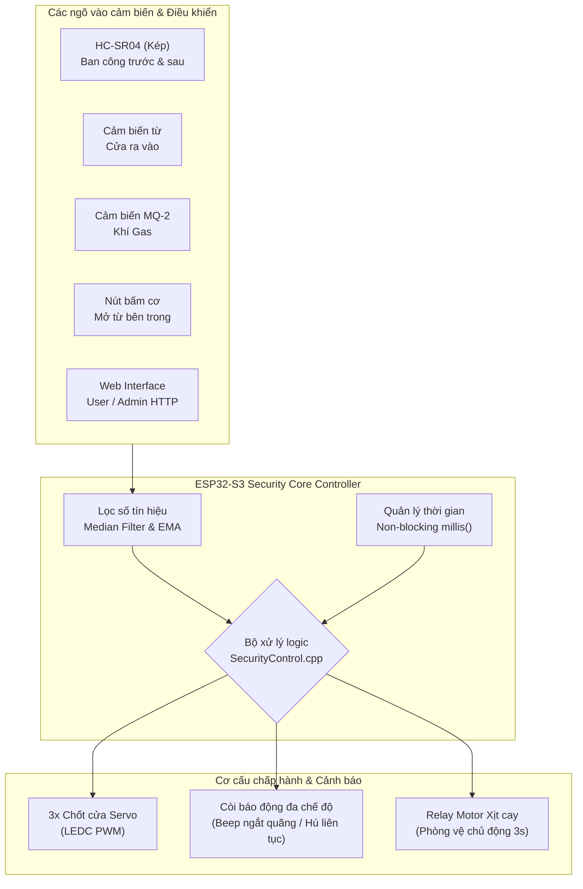

# 🛡️ SafeHome · YOLO UNO Smart Home Security System
### Hệ thống An ninh & Giám sát Nhà thông minh đa tầng trên ESP32-S3

[](https://platformio.org/)
[](https://www.arduino.cc/)
[-E7352C.svg?logo=espressif&logoColor=white)](https://espressif.com/)
[](https://platformio.org/)
[](LICENSE)

<br/>

**Dự án phát triển hệ thống kiểm soát an ninh đa tầng, tích hợp báo động, phòng vệ chủ động (xịt cay), thoát hiểm khẩn cấp khi rò rỉ khí gas và điều khiển giám sát thời gian thực qua giao diện Web cục bộ (SoftAP).**

---

[Giới thiệu](#-giới-thiệu-tổng-quan) •
[Tính năng nổi bật](#-tính-năng-nổi-bật) •
[Sơ đồ chân Pinout](#-sơ-đồ-kết-nối-phần-cứng-pinout) •
[Kiến trúc hệ thống](#-kiến-trúc-hệ-thống--logic-bảo-mật) •
[Giao diện Web](#-giao-diện-web-dashboard) •
[Cài đặt & Nạp code](#-hướng-dẫn-cài-đặt--nạp-firmware) •
[Đóng góp](#-tác-giả--đóng-góp)

---

</div>

<br/>

## 📖 Giới thiệu tổng quan

**YOLO UNO Smart Home Security System** là giải pháp an ninh IoT toàn diện được xây dựng trên nền tảng vi điều khiển **ESP32-S3-WROOM-1 (YOLO UNO - 16MB Flash, 240MHz)**. Hệ thống kết hợp nhiều lớp cảm biến (siêu âm, công tắc từ, nồng độ khí gas) và các cơ cấu chấp hành (3 chốt cửa servo 360°, còi báo động đa âm tần, relay kích hoạt cơ chế phun xịt cay răn đe).

Hệ thống hoạt động hoàn toàn độc lập thông qua **Wi-Fi SoftAP** nội bộ tích hợp Web Server siêu nhẹ, cho phép chủ nhà giám sát trực quan trạng thái và điều khiển đóng/mở cửa mà không cần phụ thuộc vào Internet bên ngoài.

---

## ✨ Tính năng nổi bật

### 1. 🚪 Kiểm soát cửa & Cơ chế chốt khóa linh hoạt
- **Hệ thống 3 chốt cửa tự động**: Điều khiển độc lập hoặc đồng bộ 3 động cơ servo 360° qua phần cứng LEDC PWM chuyên dụng của ESP32-S3.
- **Tự động khóa an toàn**: Khi mở khóa qua Web hoặc nút nhấn cơ trong nhà, hệ thống tự động khóa lại sau **10 giây**.
- **Nút nhấn vật lý bên trong**: Cho phép người trong nhà bấm mở cửa nhanh chóng với thuật toán chống rung tiếp điểm (Debounce 30ms).

### 2. 🦹 Phát hiện đột nhập & Phòng vệ chủ động
- **Cảm biến từ cửa (Door Reed Switch)**: Phát hiện cạy cửa trái phép ngay lập tức khi chốt chưa được mở hợp lệ -> Kích hoạt còi báo động ngắt quãng và **phun xịt cay trong 3 giây**.
- **Cảm biến siêu âm kép HC-SR04 (Ban công trước & sau)**:
  - Sử dụng **ngắt ngoại vi GPIO (ISR)** không làm nghẽn CPU (không dùng `pulseIn()`).
  - Lập lịch phát xung so le (Ping interval 60ms) nhằm triệt tiêu hoàn toàn hiện tượng dội âm chéo (Acoustic crosstalk).
  - Thuật toán **Median Filter (Cửa sổ 5 mẫu)** loại bỏ nhiễu ảo môi trường và cơ chế tự động cân chỉnh độ sâu chuẩn (**Auto-calibration 15 mẫu**).
  - Nếu đối tượng đứng trong vùng cảnh báo (< 10cm) quá **10 giây**, hệ thống tự động kích hoạt relay motor xịt cay phòng vệ.

### 3. 🔥 Thoát hiểm thông minh khi rò rỉ khí gas (MQ-2)
- Đo nồng độ khí gas liên tục kết hợp bộ lọc trung bình trượt hàm mũ **EMA ($\alpha = 0.2$)**.
- Bỏ qua 30 giây đầu khởi động để cảm biến MQ-2 ổn định buồng nung nhiệt (Warm-up immunity).
- Khi nồng độ vượt ngưỡng an toàn ($> 2000/4095$):
  - **Tự động bung toàn bộ 3 chốt cửa** để người trong nhà thoát hiểm.
  - **Còi hú liên tục ở mức khẩn cấp cực đại**.
  - **Khóa cơ chế xịt cay** (tuyệt đối không kích hoạt motor xịt nhằm bảo vệ tính mạng người chạy nạn).
  - Khi khí gas trở lại an toàn liên tục trong **10 giây**, hệ thống tự động đóng lại chốt.

### 4. 🌐 Web Dashboard trực quan & Bảo mật cao
- **Không phụ thuộc Internet**: Hoạt động trực tiếp qua mạng Wi-Fi AP do ESP32 phát ra.
- **Phân quyền 2 cấp độ**:
  - **User Portal (`/`)**: Xem trạng thái thẻ khóa, cảm biến, cảnh báo rò rỉ gas, nhập mã PIN mở khóa nhanh.
  - **Admin Control Panel (`/admin`)**: Đăng nhập bằng Token bảo mật (phiên làm việc 10 phút), điều khiển bật/tắt từng chốt cửa riêng biệt, can thiệp bật/tắt còi, relay và theo dõi đồ thị giá trị ADC gas trực tiếp.
- **Cơ chế chống Brute-force**: Tự động khóa đăng nhập **30 giây** nếu nhập sai mật khẩu quá **5 lần liên tiếp**.

---

## 🔌 Sơ đồ kết nối phần cứng (Pinout)

Hệ thống được thiết kế tối ưu trên vi điều khiển **YOLO UNO (ESP32-S3)**:

| Thiết bị | Chân vi điều khiển (GPIO) | Nhãn trên YOLO UNO | Kiểu tín hiệu | Chức năng chi tiết |
|:---|:---:|:---:|:---:|:---|
| **Servo 1 (Chốt 1)** | `GPIO 38` | `D11` | LEDC PWM (CH0) | Điều khiển chốt cửa 1 |
| **Servo 2 (Chốt 2)** | `GPIO 47` | `D12` | LEDC PWM (CH1) | Điều khiển chốt cửa 2 |
| **Servo 3 (Chốt 3)** | `GPIO 21` | `D10` | LEDC PWM (CH2) | Điều khiển chốt cửa 3 |
| **HC-SR04 (Ban công trước)** | `TRIG: 5` / `ECHO: 6` | `D2` / `D3` | Digital Out / GPIO ISR In | Đo khoảng cách chống leo trèo trước |
| **HC-SR04 (Ban công sau)** | `TRIG: 7` / `ECHO: 8` | `D4` / `D5` | Digital Out / GPIO ISR In | Đo khoảng cách chống leo trèo sau |
| **Cảm biến từ cửa** | `GPIO 9` | `D6` | Digital In (Pull-up) | Phát hiện trạng thái đóng/mở cánh cửa |
| **Cảm biến khí Gas MQ-2** | `GPIO 1` | `A0` | Analog In (ADC1_CH0) | Cảnh báo nồng độ khí gas / khói |
| **Còi báo động (Buzzer)** | `GPIO 10` | `D7` | Digital Out | Còi chip Active Buzzer báo động |
| **Relay Motor xịt cay** | `GPIO 17` | `D8` | Digital Out (Active LOW) | Kích hoạt motor dung dịch phòng vệ |
| **Nút bấm bên trong** | `GPIO 18` | `D9` | Digital In (Pull-up) | Nút cơ mở khóa nhanh khẩn cấp |

> [!NOTE]
> - Các động cơ Servo 360° hoạt động bằng cách điều chế xung thời gian quay (`150ms` rồi trở về góc trung tính `90°` để ngắt quay).
> - Servo 3 được chuyển về `GPIO 21 (D10)` và điều khiển trực tiếp bằng kênh phần cứng LEDC để tránh xung đột chân kênh Timer MCPWM.

---

## 🏗️ Kiến trúc hệ thống & Logic bảo mật



### Ma trận xử lý phản hồi sự cố:

| Tình huống | Chốt cửa | Còi Buzzer | Relay Xịt cay | Thời gian tự động khôi phục |
|:---|:---:|:---:|:---:|:---:|
| **Trạng thái bình thường** | Khóa (Đóng) | Tắt | Tắt | Duy trì |
| **Mở khóa qua Web / Nút bấm** | Mở | Tắt | Tắt | Tự động khóa lại sau 10s |
| **Cạy cửa trái phép** | Giữ khóa | Beep dồn dập | Kích hoạt (3s) | Dừng khi cửa đóng lại |
| **Xâm nhập ban công (< 10cm)** | Giữ khóa | Beep dồn dập | Tắt | Hết vật cản sau 1s |
| **Xâm nhập ban công (> 10s)** | Giữ khóa | Beep dồn dập | Kích hoạt (3s) | Lặp lại mỗi 10s nếu còn đứng |
| **Rò rỉ khí Gas (> 2000 ADC)** | **Tự động mở** | **Hú liên tục** | **Vô hiệu hóa** | Khóa lại khi gas sạch sau 10s |

---

## 💻 Giao diện Web Dashboard

Hệ thống tích hợp sẵn giao diện người dùng trực tiếp trong bộ nhớ Flash ROM (không yêu cầu SD Card hay Internet CDN):

### 1. Cổng điều khiển người dùng (User Portal: `http://192.168.4.1/`)
- Hiển thị khối trạng thái khóa thời gian thực: **ĐANG KHÓA (Xanh lam)** hoặc **ĐANG MỞ (Vàng cam)** kèm bộ đếm ngược giây tự khóa.
- Banner nhấp nháy đỏ cảnh báo nguy cấp khi phát hiện rò rỉ khí gas.
- Bảng hiển thị thông số 4 phân vùng: Trạng thái cửa, Nồng độ gas, Khoảng cách ban công trước & sau.
- Ô nhập mã PIN người dùng để mở khóa từ xa nhanh chóng.

### 2. Trang quản trị hệ thống (Admin Portal: `http://192.168.4.1/admin`)
- Xác thực bảo mật với Token ngẫu nhiên (Session timeout: 10 phút).
- Can thiệp thủ công: Bật/Tắt riêng lẻ Chốt 1, Chốt 2, Chốt 3.
- Ghi đè khẩn cấp: Bật/Tắt cưỡng bức còi hú hoặc kích hoạt motor relay xịt cay.
- Bảng thông số kỹ thuật chi tiết: Giá trị ADC thô của cảm biến gas, khoảng cách chuẩn Baseline của 2 cảm biến siêu âm, nút Reset toàn bộ báo động.

---

## 📂 Cấu trúc thư mục dự án

```text
ESP32/
├── platformio.ini              # Cấu hình môi trường PlatformIO cho ESP32-S3 (16MB Flash)
├── include/
│   ├── globals.h               # Header khai báo tổng thể & thư viện hệ thống
│   ├── user_page.h             # Giao diện Web HTML/CSS/JS cho User (PROGMEM)
│   └── admin_page.h            # Giao diện Web HTML/CSS/JS cho Admin (PROGMEM)
├── src/
│   ├── main.cpp                # Khởi tạo Setup và Vòng lặp Loop chính
│   ├── common/
│   │   ├── config.h            # Định nghĩa chân GPIO, hằng số cấu hình & ngưỡng cảm biến
│   │   └── config.cpp          # Mật khẩu WiFi, mã PIN mở khóa & Admin password
│   ├── connect/
│   │   ├── acceptPoint.h/.cpp  # Khởi tạo Wi-Fi Soft Access Point
│   │   └── Webserver.h/.cpp    # Xử lý các HTTP REST API endpoints & Web Server
│   ├── control/
│   │   └── SecurityControl.h/.cpp # Khối xử lý trung tâm, logic an ninh & phản xạ tự động
│   └── device/
│       ├── initSensor.h/.cpp   # Hàm bao khởi tạo và polling toàn bộ thiết bị
│       ├── TaskServo.h/.cpp    # Điều khiển 3 servo 360° qua LEDC PWM
│       ├── TaskUltrasonic.h/.cpp # Đo khoảng cách HC-SR04 qua ngắt ISR & Median filter
│       ├── TaskDoorSensor.h/.cpp # Cảm biến từ cửa sổ/cửa chính + Debounce
│       ├── TaskGasSensor.h/.cpp  # Đọc ADC MQ-2 + Bộ lọc EMA + Khử nhiễu làm nóng
│       ├── TaskBuzzer.h/.cpp   # Điều khiển còi chip (Off, Beep ngắt quãng, Hú liên tục)
│       ├── TaskRelay.h/.cpp    # Điều khiển Relay kích hoạt bình xịt phòng vệ
│       └── TaskButton.h/.cpp   # Quản lý nút bấm cơ học mở cửa bên trong
└── README.md                   # Tài liệu hướng dẫn dự án
```

---

## 🚀 Hướng dẫn cài đặt & Nạp firmware

### 1. Chuẩn bị phần cứng & phần mềm
- **Bo mạch**: YOLO UNO (hoặc bo tương thích ESP32-S3-WROOM-1 N16R8).
- **Cáp kết nối**: Cáp Type-C hỗ trợ truyền dữ liệu (cắm vào cổng USB Native của ESP32-S3).
- **Phần mềm**: [VS Code](https://code.visualstudio.com/) cài đặt sẵn Extension [PlatformIO IDE](https://platformio.org/).

### 2. Cấu hình & Biên dịch dự án
Clone dự án về máy tính:
```bash
git clone https://github.com/Cocobaut/SafeHome.git
cd SafeHome
```

Mở thư mục dự án bằng VS Code với PlatformIO.

### 3. Quy trình nạp code (Flash Firmware)
Nếu bo mạch ở chế độ chạy bình thường không nhận cổng nạp, hãy thao tác vào Bootloader:
1. Nhấn giữ nút **BOOT**.
2. Nhấn nút **RESET** (EN) rồi nhả nút **RESET**.
3. Nhả nút **BOOT** để vi điều khiển vào chế độ ROM Bootloader.
4. Trên thanh công cụ PlatformIO, chọn:
   - **PlatformIO: Build** để biên dịch mã nguồn.
   - **PlatformIO: Upload** để nạp firmware xuống ESP32-S3.
5. Sau khi nạp hoàn tất, nhấn nút **RESET** 1 lần để thoát Bootloader và khởi chạy hệ thống.

---

## 🔑 Thông số kết nối & Mật khẩu mặc định

| Mục | Giá trị mặc định | File cấu hình |
|:---|:---:|:---|
| **Tên WiFi (SSID)** | `YOLO_UNO_SECURITY` | [src/common/config.cpp](file:///e:/LABIOT/ESP32/src/common/config.cpp#L4) |
| **Mật khẩu WiFi** | `12345678` | [src/common/config.cpp](file:///e:/LABIOT/ESP32/src/common/config.cpp#L5) |
| **Địa chỉ IP Web** | `http://192.168.4.1` | Mặc định lớp mạng SoftAP |
| **Mã PIN mở khóa User** | `1234` | [src/common/config.cpp](file:///e:/LABIOT/ESP32/src/common/config.cpp#L8) |
| **Mật khẩu trang Admin** | `admin123` | [src/common/config.cpp](file:///e:/LABIOT/ESP32/src/common/config.cpp#L9) |

---

## 👥 Tác giả & Đóng góp

Dự án được nghiên cứu và phát triển bởi các thành viên:

<div align="center">

| Avatar | Thành viên | Vai trò & Đóng góp | Liên kết |
|:---:|:---|:---|:---:|
|  | **Cocobaut** | • Kiến trúc phần mềm & tích hợp hệ thống<br/>• Thiết kế thuật toán ngắt & lọc tín hiệu cảm biến siêu âm<br/>• Xây dựng Web Dashboard và quản lý bảo mật | [](https://github.com/Cocobaut) |
|  | **kcubin** | • Thiết kế mạch phần cứng & kết nối cảm biến ngoại vi<br/>• Tinh chỉnh cấu hình động cơ Servo & cơ cấu chốt cửa<br/>• Thử nghiệm và hoàn thiện logic phòng vệ an ninh | [](https://github.com/kcubin) |

</div>

---